## 1. Windows User and Group Administration

### Objective
Create a local Windows user and a local security group,
add the user to the group, and verify the configuration.

### Environment
- Virtual machine: VirtualBox (WIN-LAB01)
- Operating system: Windows 11
- User created: labuser1
- Group created: LabOps
- Tools used: Windows PowerShell

### Procedure
1. Opened PowerShell with administrator privileges.
2. Created the local group named LabOps.
3. Created the local user named labuser1.
4. Added labuser1 to the LabOps group.
5. Verified the user account and group membership
   using PowerShell commands.

### Commands Used

```powershell
New-LocalGroup -Name "LabOps" `
  -Description "Lab permissions testing group"

$Password = Read-Host "Enter a temporary lab password" -AsSecureString

New-LocalUser -Name "labuser1" `
  -Password $Password `
  -Description "Test account for administration lab"

Add-LocalGroupMember -Group "LabOps" -Member "labuser1"

Get-LocalUser -Name "labuser1"

Get-LocalGroup -Name "LabOps"

Get-LocalGroupMember -Group "LabOps"
```

### Result
The local user 'labuser1' was created successfully. The 'LabOps' group was created successfully, and 'labuser1' was added to the group. The account and group membership were verified using PowerShell.

### Analysis
Local user accounts provide individual identities
for accessing a Windows system. Groups simplify
permission management by allowing permissions to
be assigned to a collection of users rather than
configured separately for every account.

### Conclusion
This exercise demonstrated how to create and manage
local Windows user accounts and security groups
using PowerShell. I verified that the labuser1
account existed and was a member of LabOps.
This group was subsequently used in the file
permission exercise to grant access to the
TeamShare directory.

### Screenshots
1. Windows users and group
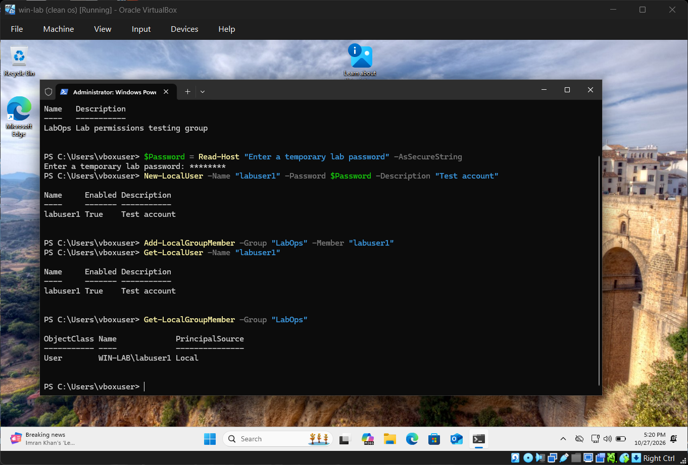


## 2. Windows File Permissions

### Objective
Configure Windows folder permissions by granting the
LabOps group Modify access to a shared directory and
verify that a member of the group can create and save files.

### Environment
- Virtual machine: VirtualBox (WIN-LAB01)
- Operating system: Windows 11
- Test user: labuser1
- Security group: LabOps
- Test directory: C:\LabData\TeamShare
- Tool: Windows PowerShell and File Explorer

### Procedure
1. Opened PowerShell with administrator privileges.
2. Created the directory C:\LabData\TeamShare.
3. Granted Modify permission to the LabOps group.
4. Verified the folder permissions using icacls command.
5. Signed in using the labuser1 account.
6. Opened the TeamShare directory.
7. Created permission-test.txt.
8. Entered test content and saved the file successfully.

### Commands Used

```powershell
New-Item -ItemType Directory -Path "C:\LabData\TeamShare" -Force

icacls "C:\LabData\TeamShare" /grant "$($env:COMPUTERNAME)\LabOps:(OI)(CI)M"

icacls "C:\LabData\TeamShare"
```

### Result
The folder permissions were configured successfully and granted Modify permission on the TeamShare directory.
The icacls output confirmed the LabOps group's Modify
permission. The labuser1 account successfully created
and saved permission-test.txt in the TeamShare directory.

### Analysis
Windows NTFS permissions control which users and groups
can access files and folders and what actions they can
perform. Assigning permissions to a group simplifies
administration because access can be managed through
group membership rather than by configuring each user
individually.

### Conclusion
This exercise demonstrated how to configure and verify
Windows folder permissions using PowerShell. I granted
the LabOps group Modify access to the TeamShare directory
and verified that labuser1 could create and save a test
file. This confirmed that the configured permissions
worked for the intended user. The exercise also showed
how group based permissions support consistent and
manageable access control.

### Screenshots
1. Windows permission & icacls command
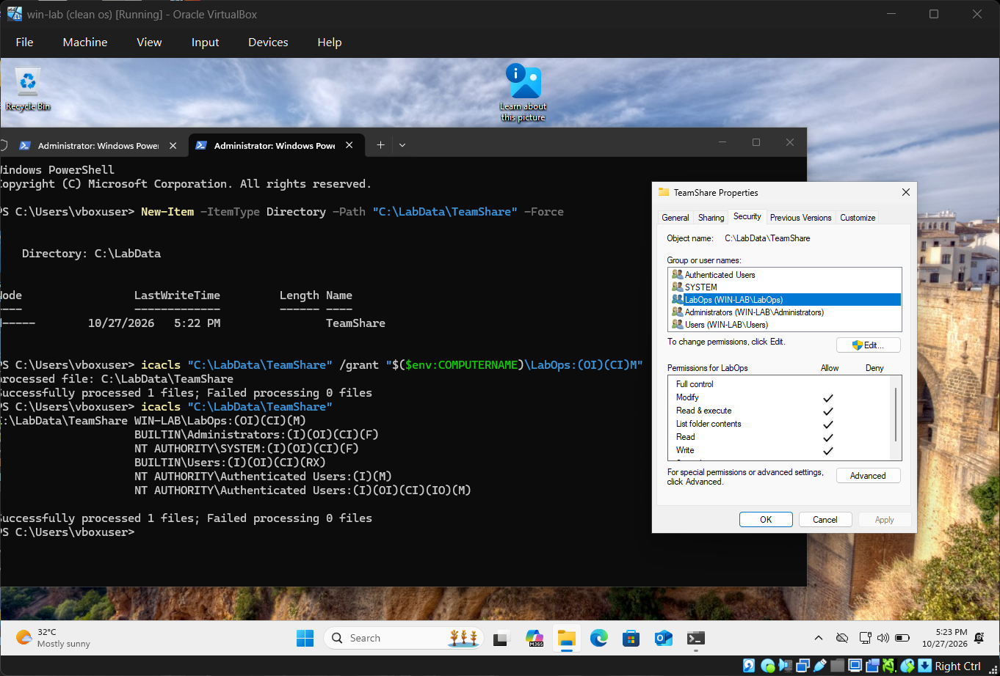
2. Permission test with file content
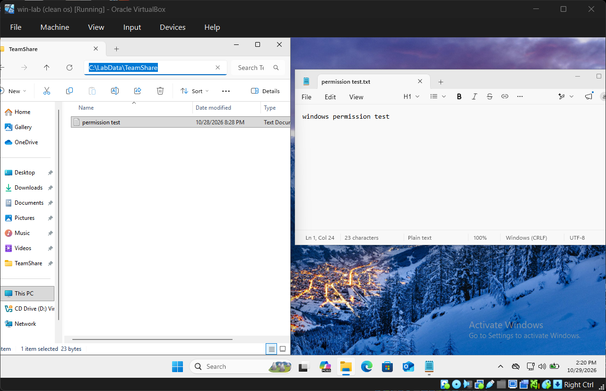

## 3. Windows System Performance Monitoring

### Objective
Monitor CPU utilisation, memory usage, disk capacity,
and running processes using Windows Task Manager
and PowerShell.

### Environment
- Virtual machine: VirtualBox (WIN-LAB01)
- Operating system: Windows 11
- Tools: Task Manager and Windows PowerShell

### Procedure
1. Opened Task Manager and selected the Performance tab.
2. Observed CPU utilisation and processor information.
3. Reviewed memory usage and available memory.
4. Inspected disk activity using Task Manager.
5. Retrieved volume capacity and remaining space using
   the Get-Volume command.
6. Listed running processes sorted by accumulated CPU time.
7. Retrieved operating system memory information using
   Get-CimInstance.

### Commands Used

```powershell
Get-Volume |
    Select-Object DriveLetter, FileSystemLabel, SizeRemaining, Size

Get-Process |
    Sort-Object CPU -Descending |
    Select-Object -First 10 Name, CPU, Id
```

### Result
CPU utilisation, memory usage, disk capacity, and
running processes were inspected using Task Manager
and PowerShell. Volume information and memory statistics
were retrieved using PowerShell commands.

### Observations
- CPU utilisation: 79% with 168 processes
- Total memory: 5.2 GB
- Free memory: 1.6 GB
- Disk capacity: 80GB
- Processes observed: svchost, system, Tiworker

### Analysis
The monitoring tools provided information about system
resource usage and running processes. CPU utilisation
represents current processor activity, while the CPU
values returned by Get-Process represent accumulated
processor time. Memory and disk information help identify
resource constraints that may affect system performance.


### Conclusion
This exercise demonstrated how to monitor Windows
system performance using Task Manager and PowerShell.
I practised inspecting CPU utilisation, memory usage,
disk capacity, and running processes. These skills are
useful for identifying resource constraints and
investigating performance-related issues.

### Screenshots
1. Windows CPU monitoring
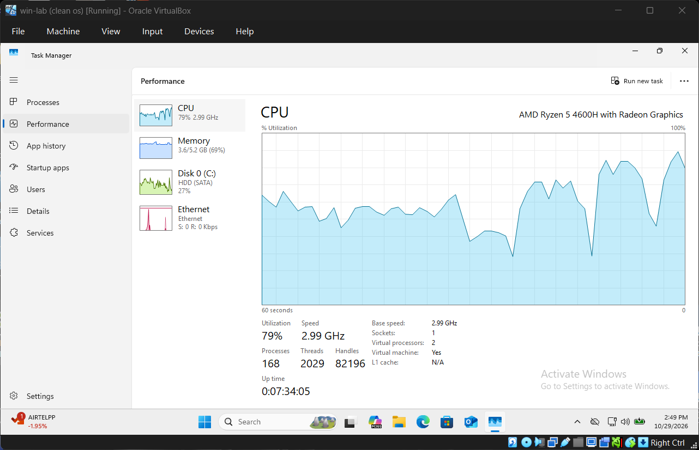
2. Windows memory monitoring
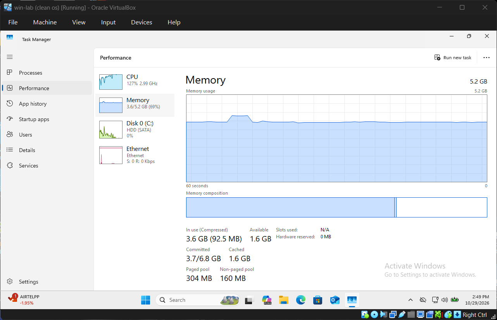
3. Windows disk monitoring
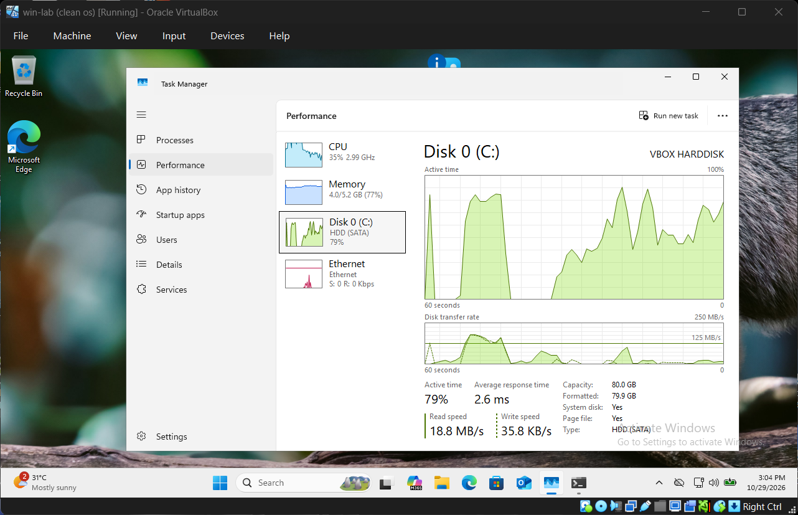
4. Windows process monitoring
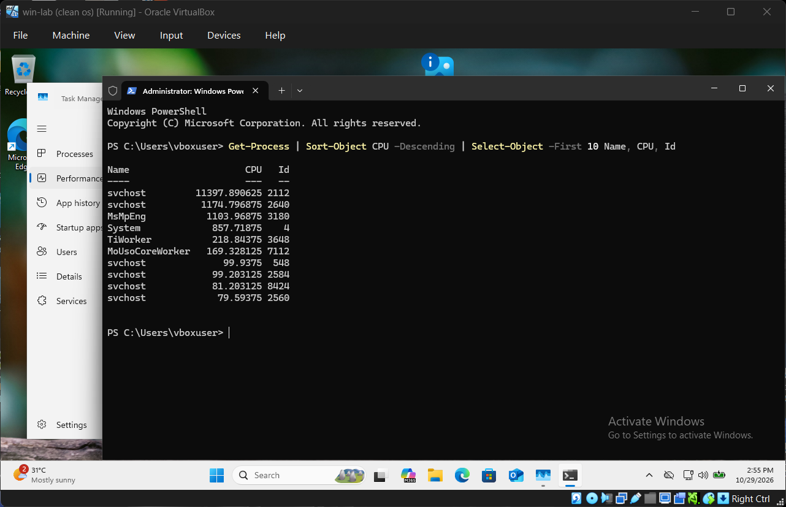

## 4. Windows Service Management and Troubleshooting

### Objective
Practise checking, stopping, starting, and investigating
a Windows service using PowerShell.

### Environment
- Virtual machine: VirtualLab (WIN-LAB01)
- Operating system: Windows 11
- Service: Print Spooler
- Service name: Spooler
- Tool: Windows PowerShell

### Procedure
1. Opened PowerShell with administrator privileges.
2. Checked the initial state of the Print Spooler service.
3. Stopped the service using Stop-Service.
4. Verified the stopped state using Get-Service.
5. Started the service using Start-Service.
6. Verified that the service returned to the Running state.
7. Retrieved service configuration information.
8. Reviewed recent Service Control Manager events.

### Commands Used

```powershell
Get-Service -Name Spooler

Stop-Service -Name Spooler

Get-Service -Name Spooler

Start-Service -Name Spooler

Get-Service -Name Spooler

Get-CimInstance Win32_Service -Filter "Name='Spooler'" |
    Select-Object Name, DisplayName, State, StartMode, StartName
```

### Result
The Print Spooler service was inspected, stopped, and
started using PowerShell. Its state was checked before
and after the operation. Service configuration information
and recent Service Control Manager events were also reviewed.

### Analysis
Windows services perform background operating system
and application tasks. Checking a service's state helps
determine whether it is running as expected. Restarting
a stopped service can restore functionality, while event
logs can provide additional information when a service
fails to start or behaves unexpectedly.

### Conclusion
This exercise demonstrated how to manage a Windows
service using PowerShell and verify its operational
state. I practised stopping and restarting the Print
Spooler service and reviewing service configuration
and event information. These skills are useful when
troubleshooting background services on Windows systems.

### Screenshots
1. Windows service before
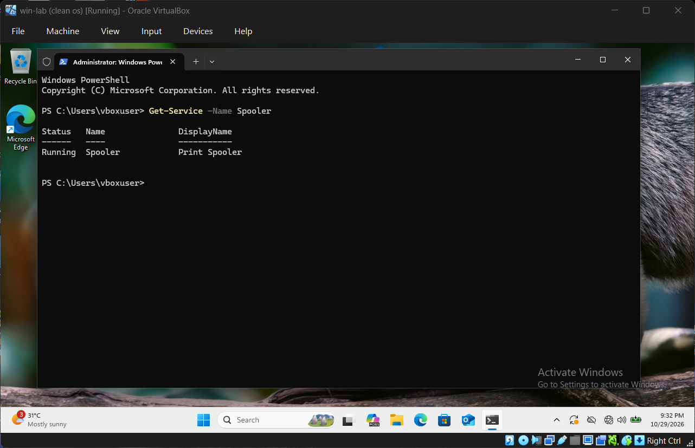
2. Windows service stopped
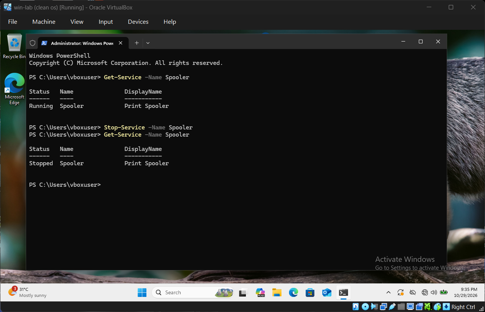
3. Windows service running
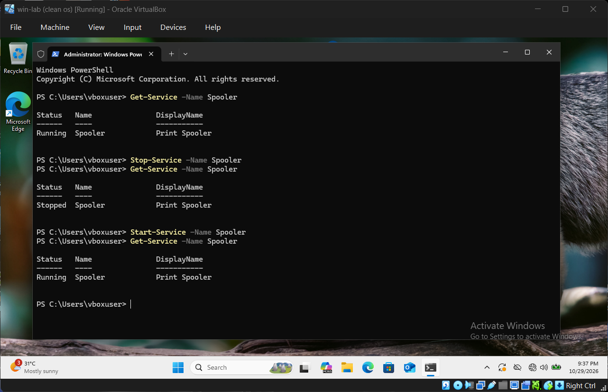
4. Windows service investigation
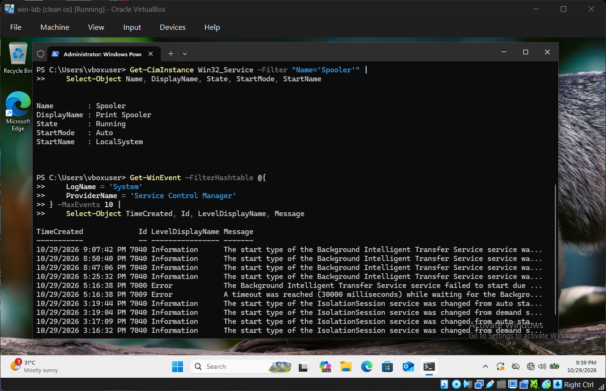

## 5. Windows Event Viewer and Log Analysis

### Objective
Review Windows system and application logs to understand
how operating system events can support troubleshooting
and system monitoring.

### Environment
- Virtual machine: VirtualBox (WIN-LAB01)
- Operating system: Windows 11
- Tools: Event Viewer and Windows PowerShell
- Logs reviewed: System and Application

### Procedure
1. Opened Event Viewer using eventvwr.msc (Windows button + R)
2. Reviewed the Windows System log.
3. Inspected Service Control Manager events where available.
4. Reviewed the Application log.
5. Retrieved recent events using Get-WinEvent.
6. Examined event timestamps, sources, IDs, severity levels,
   and messages.
7. Recorded the findings and their possible significance.

### Commands Used

```powershell
Get-WinEvent -FilterHashtable @{
    LogName = 'System'
    ProviderName = 'Service Control Manager'
} -MaxEvents 10 |
    Select-Object TimeCreated, Id, LevelDisplayName, Message |
    Format-List

Get-WinEvent -LogName Application -MaxEvents 10 |
    Select-Object TimeCreated, ProviderName, Id, LevelDisplayName, Message |
    Format-List
```

### Result
Windows System and Application logs were reviewed using
Event Viewer and PowerShell. Event details were examined
to understand their source, timestamp, severity, and message.

### Findings
- System log event: Event 7040, Service Log Manager
- Event source/provider: Service Log Manager
- Event ID: 7040

### Analysis
Windows event logs provide information about operating
system activity, application behaviour, and service events.
Reviewing event details helps administrators investigate
errors, correlate system activity, and identify issues
that may require further troubleshooting.

### Conclusion
This exercise demonstrated how to use Windows Event Viewer
and PowerShell to inspect and interpret operating system
logs. I practised reviewing event sources, timestamps,
IDs, severity levels, and messages. These skills support
Windows troubleshooting and provide a foundation for
security event investigation.

### Screenshots
1. Windows system log
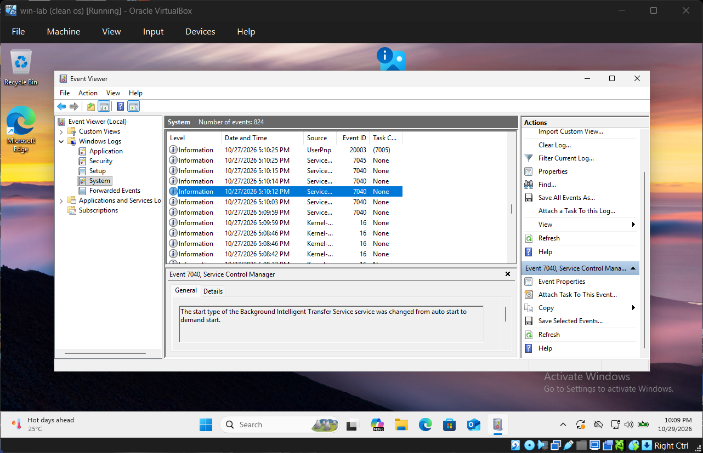
2. Windows service event
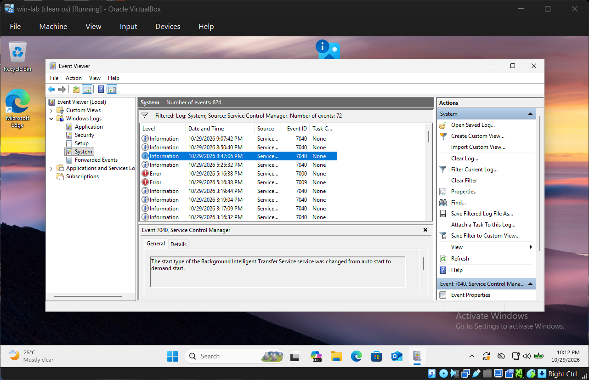
3. Windows application log
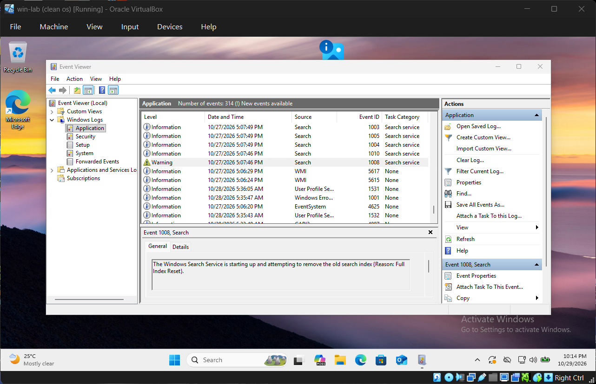
4. Windows event powershell

